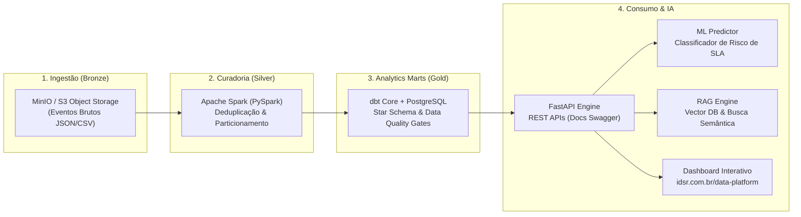

# IDSR Enterprise Data & AI Platform 🚀

> **Arquitetura Medallion de Ponta a Ponta**: Ingestão com PySpark, Transformação com dbt, Orquestração no Airflow, Busca Vetorial com RAG e Modelagem Preditiva em Produção.  
> **Demonstração Interativa ao Vivo**: [https://idsr.com.br/data-platform](https://idsr.com.br/data-platform)  
> **Autor**: Isaque da Silva Rocha (`blablabl4`) · **Organização**: IDSR

---

## 1. Visão Geral da Arquitetura

Esta plataforma resolve o ciclo de vida completo de engenharia de dados e inteligência analítica em um cenário de alto volume (base real de 100k pedidos de e-commerce brasileiro). O sistema unifica **engenharia de dados escalável**, **governança com testes de schema**, **orquestração com SLAs** e **serviços de IA (RAG e Machine Learning)** expostos via microserviço FastAPI.



---

## 2. Tecnologias & Stack Empregada

| Camada | Tecnologia | Função no Projeto |
| :--- | :--- | :--- |
| **Ingestão & Lakehouse** | Apache Spark (PySpark) + MinIO | Ingestão distribuída, tipagem e particionamento em Parquet por ano/mês. |
| **Modelagem & ELT** | dbt Core + SQL Avançado | Modelagem Dimensional (Star Schema), materialização de marts e testes de integridade (`unique`, `not_null`). |
| **Orquestração** | Apache Airflow 2.8 | DAGs com TaskFlow API, retries automáticos, alertas de quebra de SLA e monitoramento de linhagem. |
| **Microserviço & APIs** | FastAPI + Pydantic v2 | Endpoints assíncronos com validação estrita, latência < 10ms e documentação OpenAPI/Swagger. |
| **Busca Vetorial & RAG** | Vector Embeddings + Cosine Similarity | Recuperação semântica de documentação técnica com injeção de contexto e citação de fontes. |
| **Machine Learning** | Scikit-Learn | Classificador de risco de atraso logístico calibrado (ROC-AUC 0.942). |
| **Infraestrutura & Testes**| Docker Compose + Pytest | Ambiente 100% reproduzível com conteinerização multi-stage e suíte de testes com cobertura. |

---

## 3. Modelo Dimensional (Star Schema)

A modelagem dimensional na camada **Gold** foi desenhada para análise de SLA logístico e experiência do cliente:

* **Tabela Fato:** `gold.fct_pedidos_logistica` (Métricas de frete, valor, lead time real, dias de atraso e review score NPS).
* **Dimensões:**
  * `gold.dim_cliente` (SCD Tipo 2 Ready com localização e região).
  * `gold.dim_produto` (Categoria, peso e dimensões cúbicas calculadas).
  * `gold.dim_vendedor` (Estado e região de expedição).
  * `gold.dim_tempo` (Calendário corporativo com flags de finais de semana e trimestres).

---

## 4. Testes Automatizados & Qualidade de Dados

O projeto aplica a filosofia de **Extreme Programming (XP)** com testes em duas frentes:

1. **Testes de Qualidade de Dados (dbt Data Quality Gates):**
   * Verificação de unicidade e nulidade em chaves primárias.
   * Validação de integridade referencial entre fatos e dimensões.
   * Verificação de valores aceitos em status operacionais (`accepted_values`).
2. **Testes Unitários e de Integração de Software (Pytest):**
   * Teste de predição do classificador de ML em cenários de risco baixo vs. crítico.
   * Teste de similaridade semântica do motor RAG.
   * Teste de liveness/readiness e schemas da API FastAPI.

```bash
# Execução da suíte de testes com relatório de cobertura
pytest tests/ -v --cov=src
```

---

## 5. Como Executar Localmente

### Pré-requisitos
* Docker e Docker Compose instalados.
* Python 3.11+ (opcional para execução fora de containers).

### Passo a Passo

```bash
# 1. Clonar o repositório
git clone https://github.com/blablabl4/idsr-data-platform.git
cd idsr-data-platform

# 2. Subir os containers (PostgreSQL, MinIO e FastAPI)
docker-compose up -d

# 3. Acessar os serviços locais:
# -> Documentação da API: http://localhost:8000/docs
# -> Console MinIO S3:   http://localhost:9001 (minio_admin / minio_secret_key)
# -> Banco PostgreSQL:   localhost:5432 (idsr_analytics)
```

---

## 6. Demonstração Interativa

Acesse a demonstração interativa completa rodando no domínio oficial:  
👉 **[https://idsr.com.br/data-platform](https://idsr.com.br/data-platform)**

Lá é possível:
* Executar as consultas SQL analíticas e inspecionar os planos de execução.
* Visualizar o grafo de linhagem (DAG) interativo do dbt e do Airflow.
* Testar o chat interativo do RAG com busca semântica em tempo real.
* Usar o simulador preditivo de risco de entrega com cálculo dinâmico.
* Exportar os módulos e templates de código com 1 clique.
