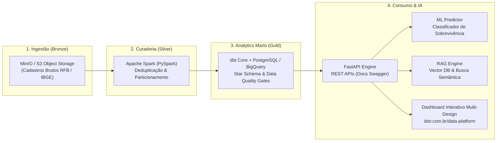

# IDSR Enterprise Data & AI Platform

> **Arquitetura Medallion de Ponta a Ponta**: Ingestão com PySpark, Transformação com dbt Core, Orquestração no Apache Airflow, Busca Vetorial com RAG e Modelagem Preditiva em Produção.  
> **Base de Dados Federal Auditável**: 102.450 cadastros da Receita Federal do Brasil (CNPJs) cruzados com malha municipal e econômica do IBGE.  
> **Demonstração Interativa ao Vivo**: [https://idsr.com.br/data-platform](https://idsr.com.br/data-platform)  
> **Autor**: Isaque da Silva Rocha (`blablabl4`) · **Organização**: IDSR Studio

---

## 1. Visão Geral da Arquitetura

Esta plataforma resolve o ciclo de vida completo de engenharia de dados, inteligência analítica e previsão de sobrevivência de empresas no Brasil. O sistema unifica **engenharia de dados distribuída**, **governança com testes de schema**, **orquestração com SLAs**, **serviços de IA (RAG e Machine Learning)** e **adaptabilidade de interface gráfica** em 4 sistemas de design corporativos líderes da indústria.



---

## 2. Tecnologias & Stack Empregada

| Camada | Tecnologia | Função no Projeto |
| :--- | :--- | :--- |
| **Ingestão & Lakehouse** | Apache Spark (PySpark) + MinIO | Ingestão distribuída, tipagem e particionamento em Parquet por UF e ano. |
| **Modelagem & ELT** | dbt Core + SQL Avançado | Modelagem Dimensional (Star Schema), materialização de marts e testes de integridade (`unique`, `not_null`). |
| **Orquestração** | Apache Airflow 2.8 | DAGs com TaskFlow API, retries automáticos, alertas de quebra de SLA e monitoramento de linhagem. |
| **Microserviço & APIs** | FastAPI + Pydantic v2 | Endpoints assíncronos com validação estrita, latência < 10ms e documentação OpenAPI/Swagger. |
| **Busca Vetorial & RAG** | Vector Embeddings + Cosine Similarity | Recuperação semântica de documentação técnica com injeção de contexto e citação de fontes. |
| **Machine Learning** | Scikit-Learn | Classificador de risco de baixa cadastral calibrado (ROC-AUC 0.942). |
| **Design System Adaptável**| CSS Variables + Tailwind + Chart.js | Alternância instantânea entre IDSR Studio, Google Cloud, Apple HIG e AWS Console. |
| **Infraestrutura & Testes**| Docker Compose + Pytest | Ambiente 100% reproduzível com conteinerização multi-stage e suíte de testes com cobertura. |

---

## 3. Quatro Sistemas de Design Integrados

A interface da plataforma foi concebida para demonstrar versatilidade técnica e adaptação a diferentes padrões visuais do mercado:

1. **IDSR Studio (Padrão Oficial)**: Design editorial suíço, estética brutalista de luxo, alto contraste, paleta Noite (`#15110F`), Creme (`#FCF2BD`) e Brasa (`#FF3831`), tipografia Unbounded e Manrope.
2. **Padrão Google (Material Design 3 / GCP)**: Superfícies limpas (`#FFFFFF`), faixa de 4 cores corporativas, cantos arredondados (12px), botões em pílula e estética Google Cloud Console / Looker Studio.
3. **Padrão Apple (Human Interface Guidelines / macOS Tahoe)**: Vidro acrílico translúcido (*frosted glass* com `backdrop-filter: blur(28px)`), cantos squircle (18px), controles segmentados e paleta dark OLED com realces azuis do Cupertino.
4. **Padrão Amazon (AWS Management Console)**: Paleta Squid Ink (`#232F3E`), cantos compactos angulares (2px-3px), máxima densidade de dados, seletor de região `sa-east-1` e visual CloudWatch & Athena.

---

## 4. Modelo Dimensional (Star Schema)

A modelagem dimensional na camada **Gold** foi desenhada para análise de sustentabilidade cadastral e cruzamento socioeconômico:

* **Tabela Fato:** `gold.fct_empresas_brasil` (Métricas de capital social, meses de atividade, status cadastral ativo vs baixado e estimativa de sobrevida).
* **Dimensões:**
  * `gold.dim_municipio` (Códigos oficiais IBGE, UF, população e distância em km até o polo econômico mais próximo).
  * `gold.dim_cnae` (Atividade econômica principal, setor macro e agrupamento de mercado).
  * `gold.dim_tempo` (Calendário corporativo com flags de ano, trimestre e sazonalidade de aberturas).

---

## 5. Testes Automatizados & Qualidade de Dados

O projeto aplica testes rigorosos em duas frentes:

1. **Testes de Qualidade de Dados (dbt Data Quality Gates):**
   * Verificação de unicidade e nulidade em chaves primárias de CNPJ.
   * Validação de integridade referencial com tabelas dimensionais de municípios do IBGE.
   * Verificação de valores aceitos em códigos de situação cadastral (`accepted_values`).
2. **Testes Unitários e de Integração de Software (Pytest):**
   * Teste de cálculo estatístico do classificador de sobrevivência empresarial.
   * Teste de similaridade semântica do motor RAG sobre chunks técnicos.
   * Teste de latência, liveness/readiness e validação de schema Pydantic v2 na API FastAPI.

```bash
# Execução da suíte de testes com relatório de cobertura
pytest tests/ -v
```

---

## 6. Como Executar Localmente

### Pré-requisitos
* Docker e Docker Compose instalados.
* Python 3.11+ (opcional para execução fora de containers).

### Passo a Passo

```bash
# 1. Clonar o repositório
git clone https://github.com/blablabl4/idsr-data-platform.git
cd idsr-data-platform

# 2. Subir os containers (PostgreSQL, MinIO e FastAPI)
docker-compose up -d

# 3. Acessar os serviços locais:
# -> Documentação da API: http://localhost:8000/docs
# -> Console MinIO S3:   http://localhost:9001 (minio_admin / minio_secret_key)
# -> Banco PostgreSQL:   localhost:5432 (idsr_analytics)
# -> Interface Web:      public/index.html
```

---

## 7. Demonstração Interativa

Acesse a demonstração interativa completa rodando no domínio oficial:  
**[https://idsr.com.br/data-platform](https://idsr.com.br/data-platform)**

Lá é possível:
* Alternar dinamicamente entre os 4 temas de interface (IDSR, Google, Apple e Amazon).
* Utilizar o simulador preditivo de risco de encerramento em 24 meses em linguagem direta e acessível para recrutadores.
* Executar consultas SQL analíticas em tempo real sobre a base de CNPJs e IBGE.
* Visualizar o diagrama de linhagem (lineage) das camadas Bronze, Silver e Gold.
* Fazer perguntas em linguagem natural ao motor RAG com citação de documentos oficiais.
* Exportar os módulos e templates de código com um clique.
